# CuteLauncher

[Русский](README.md) · [English](README_EN.md)

**Ваш домашний экран для Android TV и Google TV — с удобным управлением пультом,
собственными разделами приложений и оформлением под ваш телевизор.**

CuteLauncher объединяет запуск приложений, полезные виджеты и доступ к управлению
ТВ на одном экране. Вы сами выбираете, что показывать, как расположить элементы
и какие действия должны быть под рукой. В домашнем экране лаунчера нет рекламных
блоков. Автор — [Kirill Shchetinnikov](https://github.com/KirillShchetinnikov).

**[Скачать APK](https://github.com/KirillShchetinnikov/CuteLauncher-Releases/releases/latest)**
· **[Руководство пользователя](docs/USER_GUIDE_RU.md)**
· **[Вся документация](docs/README.md)**
· **[Что нового](CHANGELOG_RU.md)**

**CuteLauncher 1.1 — публичная стабильная версия, вышедшая из бета-стадии.**

## Что делает его удобным

- **Управление с дивана.** Навигация стрелками и OK, заметное выделение,
  контекстные действия по удержанию и настраиваемое поведение Home/Back.
- **Свой порядок приложений.** Создавайте разделы, собирайте избранное, меняйте
  порядок и скрывайте лишнее. Доступны ленты и сетки, общие и отдельные настройки
  разделов.
- **Оформление под себя.** Выбирайте стиль плиток, цвета, размеры, подписи,
  прозрачность, выделение и сторону меню. Эффекты можно настраивать или отключать.
- **Нужная информация рядом.** Часы, календарь, погода, сеть, трафик, входы ТВ,
  уведомления и таймер отключения собираются в настраиваемой верхней панели.
- **Комфорт вечером.** Ночной фильтр с затемнением и теплотой работает вручную,
  по времени или закату/рассвету; предусмотрены исключения приложений и HDMI.
- **Настройки можно сохранить.** Резервные копии, автоматическое расписание
  и выборочная синхронизация помогают переносить оформление и настройки между ТВ.

## Скриншоты

Примеры оформления в версии **1.0.24**, снятые на эмуляторах Android TV и Google TV (Android 16). Все снимки — из работающего приложения, в разрешении 3840 × 2160; нажмите на изображение, чтобы открыть оригинал. Показанные сторонние приложения устанавливаются отдельно.

| Стекло · осенний пейзаж | Стандартный стиль · графитовый градиент |
|---|---|
| [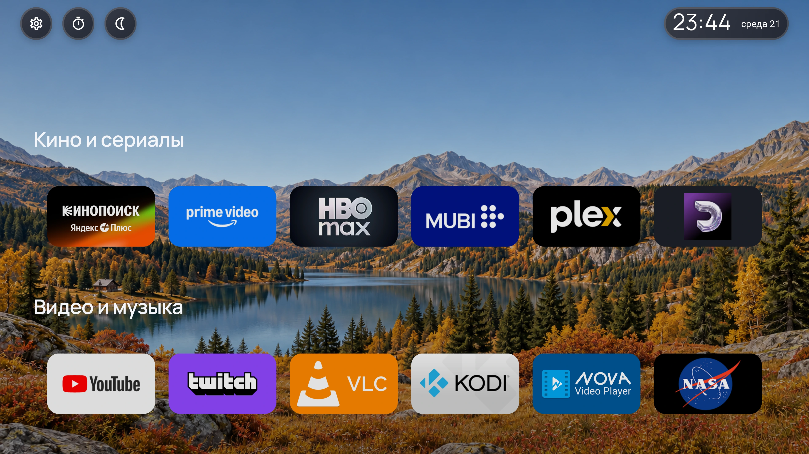](docs/images/screenshots/01-glass-autumn.webp) | [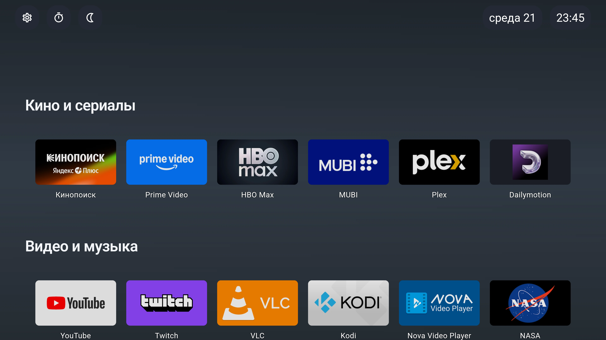](docs/images/screenshots/05-standard-gradient.webp) |

| Мягкий стиль · весенний пейзаж | Контурный стиль · рисованный ночной пейзаж |
|---|---|
| [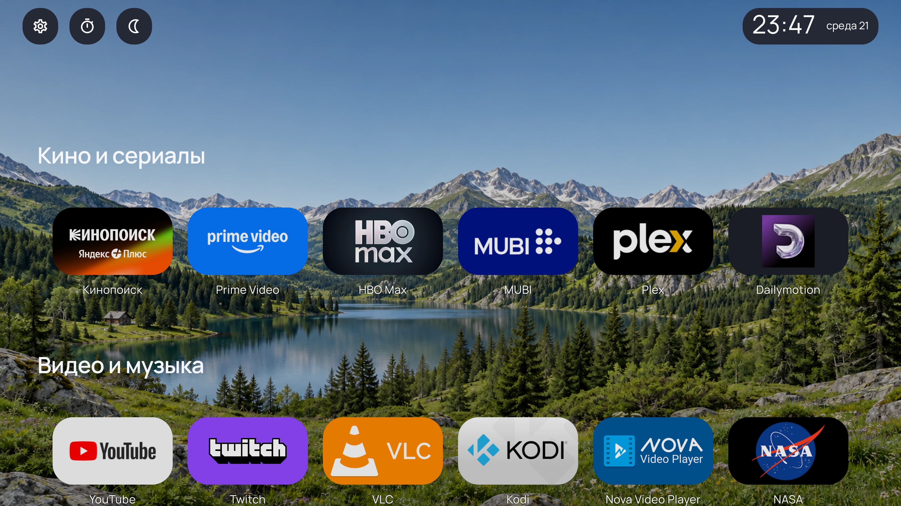](docs/images/screenshots/07-soft-spring.webp) | [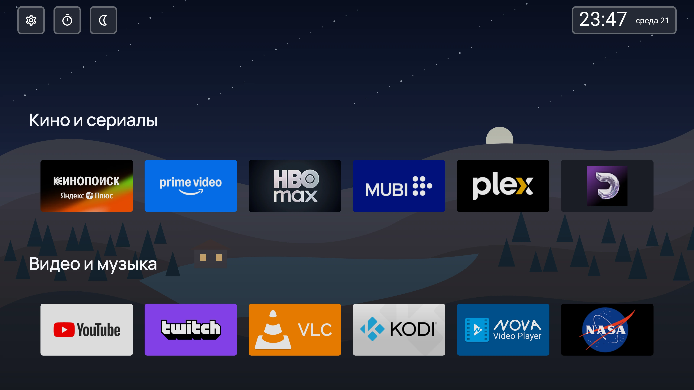](docs/images/screenshots/09-outline-night.webp) |

Ещё 8 снимков: возможности и настройки

| Стеклянные настройки | Контурные настройки |
|---|---|
| [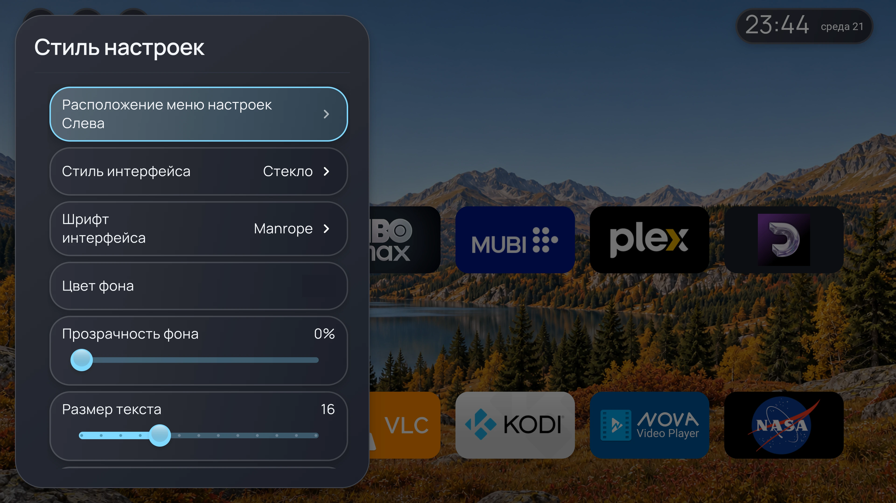](docs/images/screenshots/02-glass-settings.webp) | [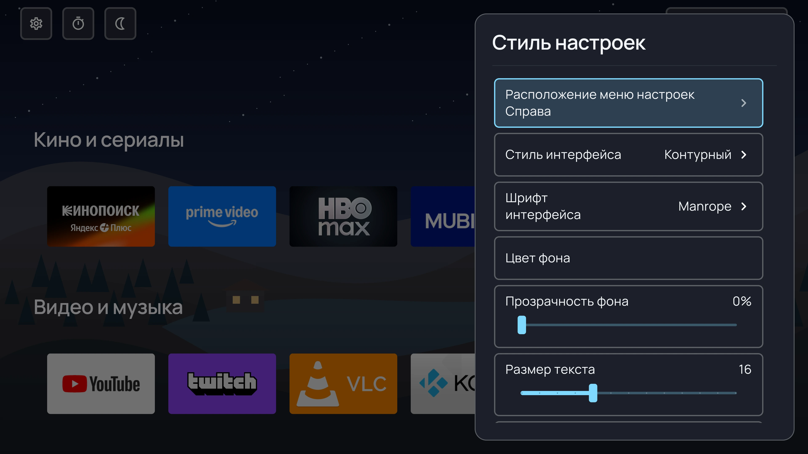](docs/images/screenshots/10-outline-settings.webp) |

| Календарь с верхней панели | Таймер отключения |
|---|---|
| [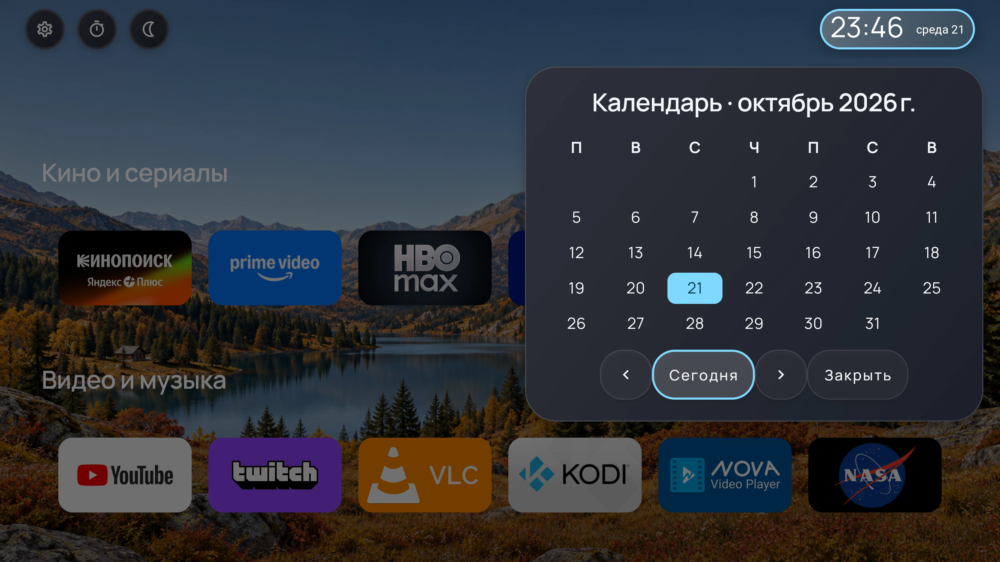](docs/images/screenshots/03-calendar.webp) | [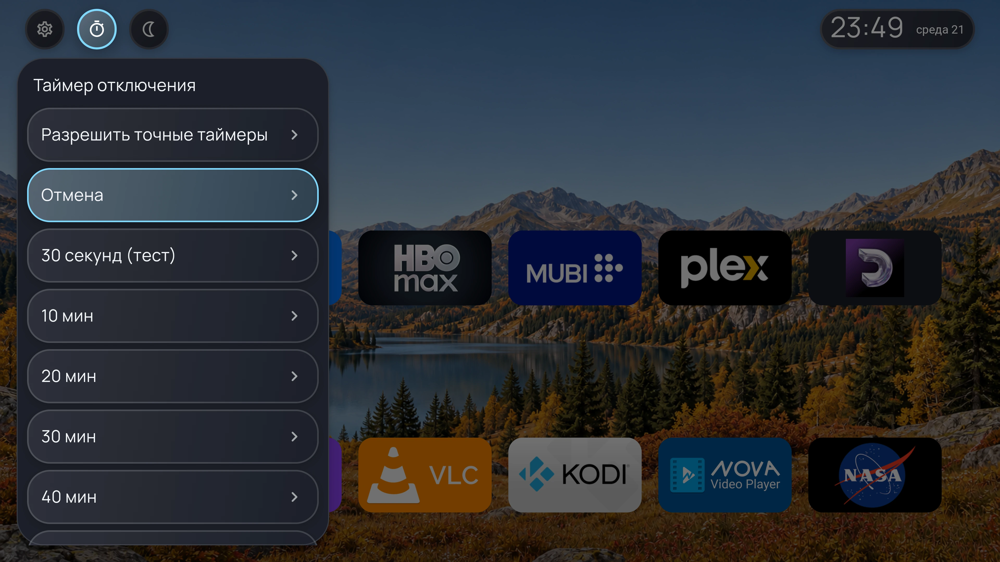](docs/images/screenshots/04-sleep-timer.webp) |

| Свои разделы приложений | Настраиваемая верхняя панель |
|---|---|
| [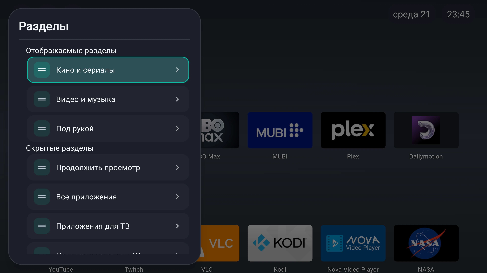](docs/images/screenshots/06-sections.webp) | [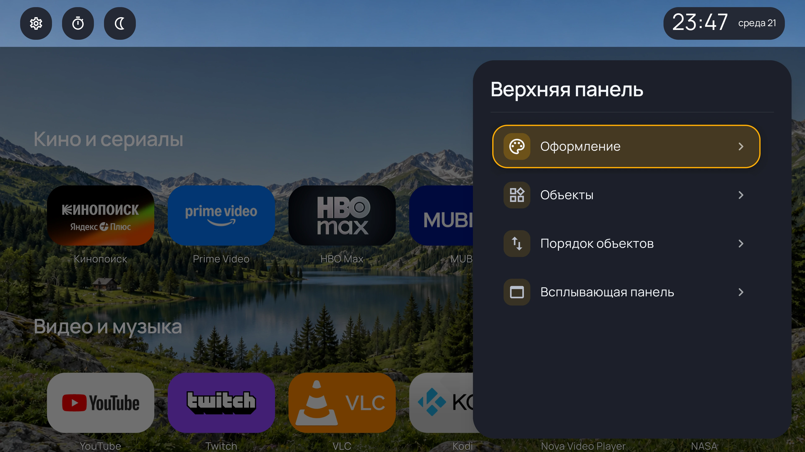](docs/images/screenshots/08-top-panel.webp) |

| Адаптивные обои | Размеры и подписи плиток |
|---|---|
| [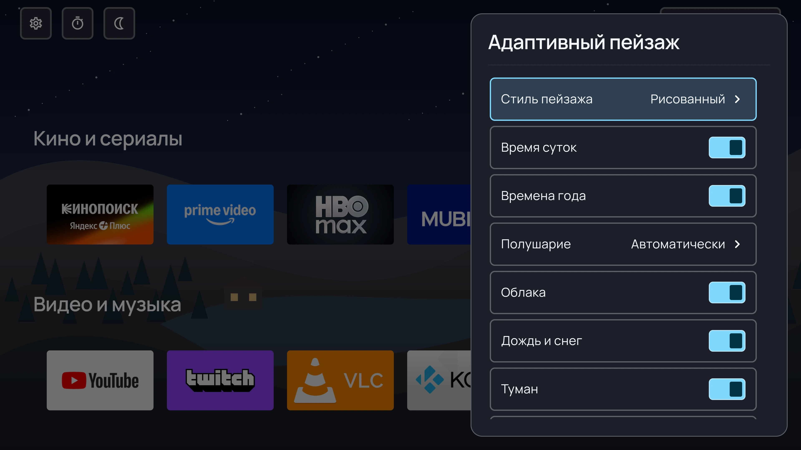](docs/images/screenshots/11-adaptive-wallpaper.webp) | [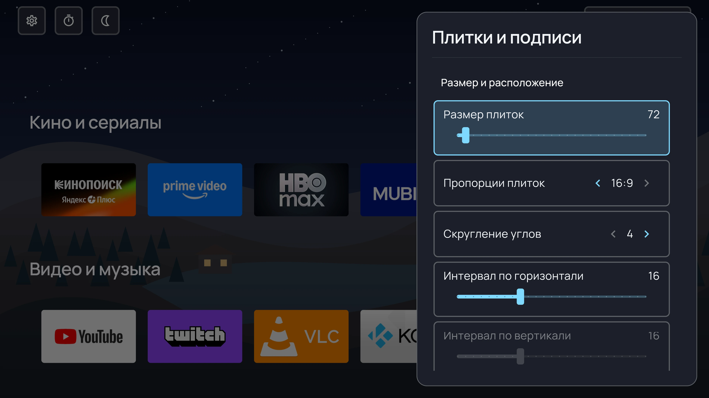](docs/images/screenshots/12-tile-appearance.webp) |

## Основные возможности

### Приложения и домашний экран

Пользовательские разделы, избранное, сортировка, скрытые и системные приложения,
собственные баннеры плиток и быстрый доступ к сведениям о приложении.
«Продолжить просмотр» показывает программы из системного Watch Next там,
где их предоставляют прошивка и установленные приложения.

### Фон, виджеты и мультимедиа

Локальные изображения и папки обоев, онлайн-обои Bing, дневной и ночной фон,
а также фон по изображению выбранного приложения. Часы и дата имеют собственное
оформление; по дате открывается календарь. Погода поддерживает Breezy Weather,
Open-Meteo, MET Norway, OpenWeather и Яндекс с требованиями выбранного источника.
После выдачи соответствующего доступа доступны уведомления и карточка
«Сейчас воспроизводится» с действиями активного плеера.

### Ночной режим и повседневное управление ТВ

Плавные переходы ночного фильтра, расписание системной яркости, часы и заставка,
таймер перехода в ожидание, переключение доступных входов и подписи HDMI/CEC.
Есть настройка домашнего приложения, восстановление прежнего HOME и встроенное
подключение ADB для поддерживаемых системных действий. Ремаппер позволяет задавать
короткое нажатие и удержание кнопок, запуск приложения, Home/Back, webhook
и открытие всплывающей панели; системная работа этих возможностей ещё требует
проверки на конкретной прошивке.

### Сохранность настроек и диагностика

Ручные и автоматические копии, локальные папки, WebDAV и Google Drive при
настроенном доступе. Выборочная синхронизация позволяет оставить часть настроек
индивидуальной для каждого ТВ. Встроены проверка обновлений APK, сведения
о памяти, режим экономии ресурсов и экспорт диагностических отчётов.

Менеджер очистки ТВ показывает пакеты и их состояния, поддерживает импорт
списков, отключение выбранных приложений через ADB и восстановление сохранённого
состояния. Он не удаляет данные приложений; безопасность стороннего списка
отключений нельзя считать подтверждённой для любой модели ТВ.

## Установка и совместимость

Скачайте APK из [последнего релиза](https://github.com/KirillShchetinnikov/CuteLauncher-Releases/releases/latest)
и установите его на телевизор или приставку. Доступны ARMv7, ARM64, x86_64
и universal; если архитектура неизвестна, можно выбрать universal.
Android может потребовать разрешение установки из выбранного источника.

Заявлена поддержка **Android 11 и новее**. Запуск на Android 11 пока не подтверждён;
проект продолжает развиваться. Выбор домашнего приложения, Home, ADB, наложения,
подсветка, уведомления и входы зависят от прошивки и выданных доступов.
Лаунчер можно использовать для запуска и организации приложений без включения
всех дополнительных системных интеграций.

Подробности доступности и ограничения приведены в
[руководстве](docs/USER_GUIDE_RU.md#разрешения-и-ограничения).
Для облачных провайдеров и части системных функций остаются незавершённые
интеграционные проверки. Возможность в текущем коде не означает, что она уже
входит в установленный APK или проверена на любой прошивке.

## Документация и исходный код

- [Руководство пользователя](docs/USER_GUIDE_RU.md) — функции, пути в настройках,
  разрешения и ограничения.
- [Установка, разрешения и ограничения](docs/USER_GUIDE_RU.md#разрешения-и-ограничения) —
  требования дополнительных функций и особенности прошивок.
- [Документация](docs/README.md) — навигация по руководству, авторство и лицензии.

Открытый код и APK находятся в
[KirillShchetinnikov/CuteLauncher-Releases](https://github.com/KirillShchetinnikov/CuteLauncher-Releases).
Документация доступна на русском и английском; ссылки переключения находятся
в начале каждой страницы.

## Лицензия и авторство

CuteLauncher развивается на основе LTvLauncher/FLauncher и распространяется
по [GNU GPLv3](LICENSE). Сведения об исходных проектах, авторах и лицензиях
библиотек и ресурсов — в [разделе о происхождении](docs/README.md#происхождение-и-лицензии).
