# CuteLauncher

[Русский](README.md) · [English](README_EN.md)

**Домашний экран для Android TV и Google TV.** Любимые приложения, ленты и управление телевизором — на одном экране без рекламных блоков. Для навигации достаточно стрелок и кнопки OK. Работает на Android 9 и новее.

**[Скачать APK](https://github.com/KirillShchetinnikov/CuteLauncher-Releases/releases/latest)** · [Как установить](#установка-и-совместимость) · [Что нового](CHANGELOG_RU.md)

[Сайт проекта](https://kirillshchetinnikov.github.io/CuteLauncher-Releases/) · [Руководство](docs/USER_GUIDE_RU.md) · [FAQ](docs/FAQ_RU.md) · [Вся документация](docs/README.md)

[Обсуждение на 4PDA](https://4pda.to/forum/index.php?showtopic=1128313&view=findpost&p=145636324) · [Поддержать разработчика](#поддержать-разработчика)

## Что можно сделать с главного экрана

- **Собрать свой порядок приложений.** Вынесите избранное в первый ряд, разложите остальные приложения по разделам и скройте лишние плитки. Для каждого раздела можно выбрать ленту или сетку.
- **Продолжить просмотр.** Если приложение передаёт данные в системную ленту Android TV, вернуться к фильму или серии можно по карточке «Продолжить просмотр».
- **Управлять телевизором с пульта.** Удерживайте OK на плитке для действий с приложением. На панель быстрых настроек можно вынести входы ТВ, уведомления и таймер отключения.
- **Увидеть нужное издалека.** Настройте размер часов, подписей и плиток, выберите заметное выделение. Погоду и дату можно разместить рядом с часами, а фон менять по времени суток.
- **Подготовить ТВ к вечернему просмотру.** Ночной фильтр включается вручную, по расписанию или после заката. Для отдельных приложений и входов HDMI можно задать исключения.
- **Перенести настройки на другой телевизор.** Сохраните резервную копию разделов и оформления или настройте выборочную синхронизацию между устройствами.

## Скриншоты и оформление

Показать 14 скриншотов и анимации обоев

Примеры оформления, снятые на эмуляторах Android TV и Google TV (Android 16). Все снимки — из работающего приложения, в разрешении 3840 × 2160; нажмите на изображение, чтобы открыть оригинал. Показанные сторонние приложения устанавливаются отдельно.

| Стекло · осенний пейзаж | Стандартный стиль · графитовый градиент |
|---|---|
| [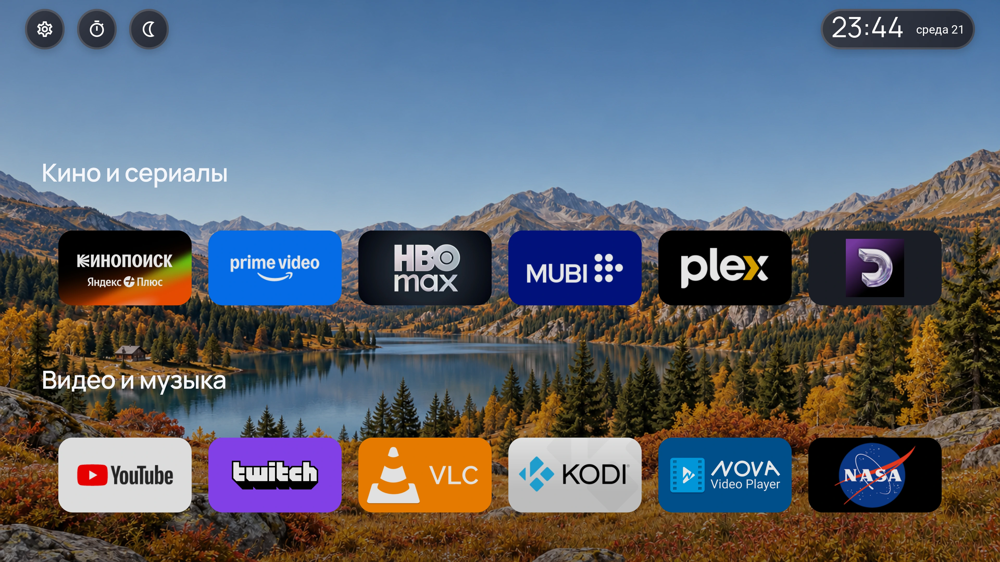](docs/images/screenshots/01-glass-autumn.webp) | [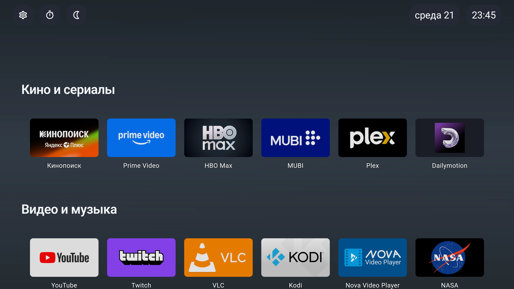](docs/images/screenshots/05-standard-gradient.webp) |

| Мягкий стиль · весенний пейзаж | Контурный стиль · рисованный ночной пейзаж |
|---|---|
| [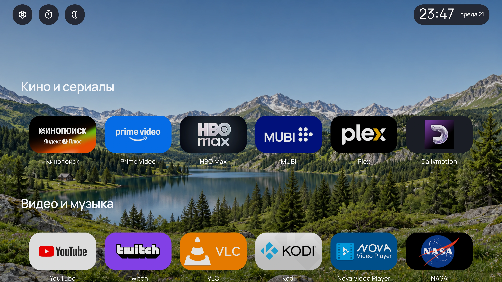](docs/images/screenshots/07-soft-spring.webp) | [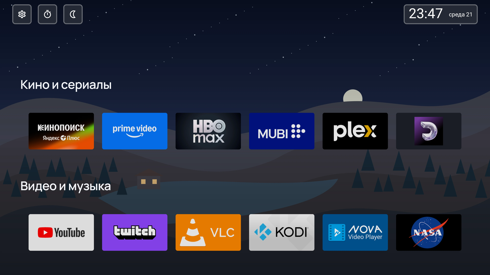](docs/images/screenshots/09-outline-night.webp) |

| Динамические цвета · сетка в шесть колонок | Панель быстрых настроек · таймер отключения |
|---|---|
| [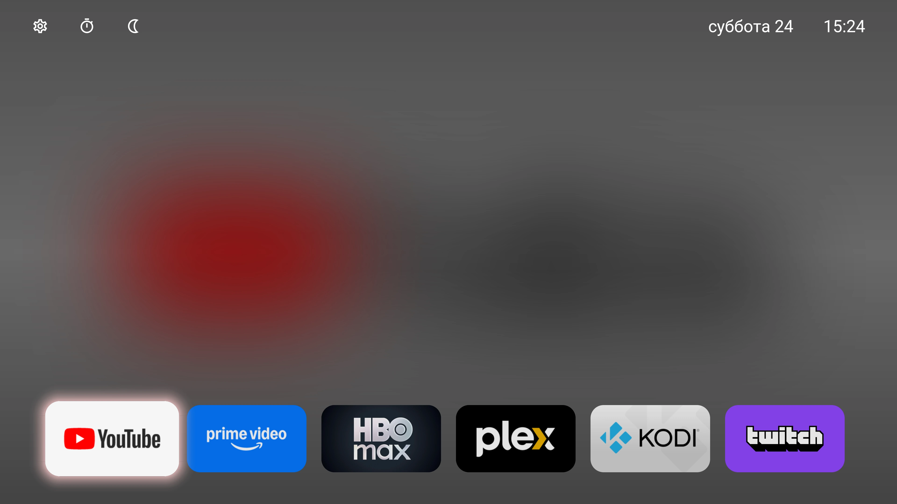](docs/images/screenshots/13-dynamic-grid.webp) | [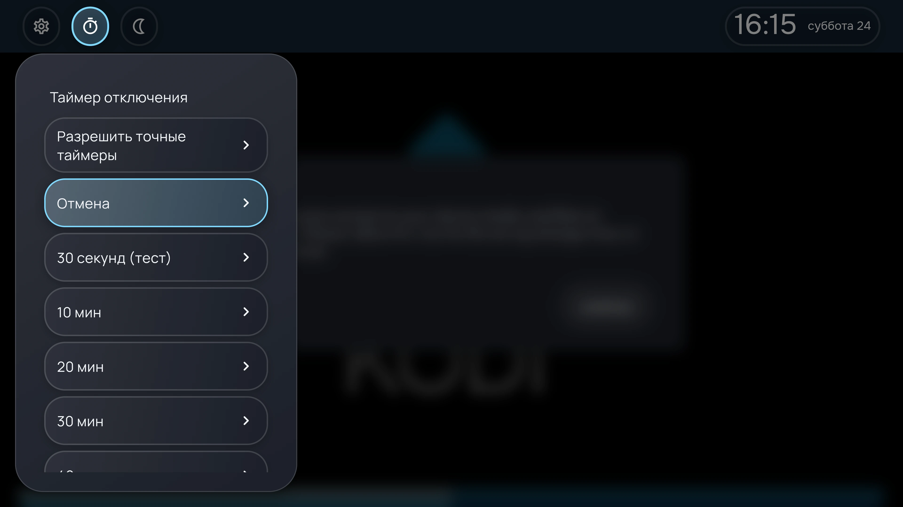](docs/images/screenshots/14-floating-panel-timer.webp) |

Фон приложения на снимке панели быстрых настроек размыт для наглядности.

| Стеклянные настройки | Контурные настройки |
|---|---|
| [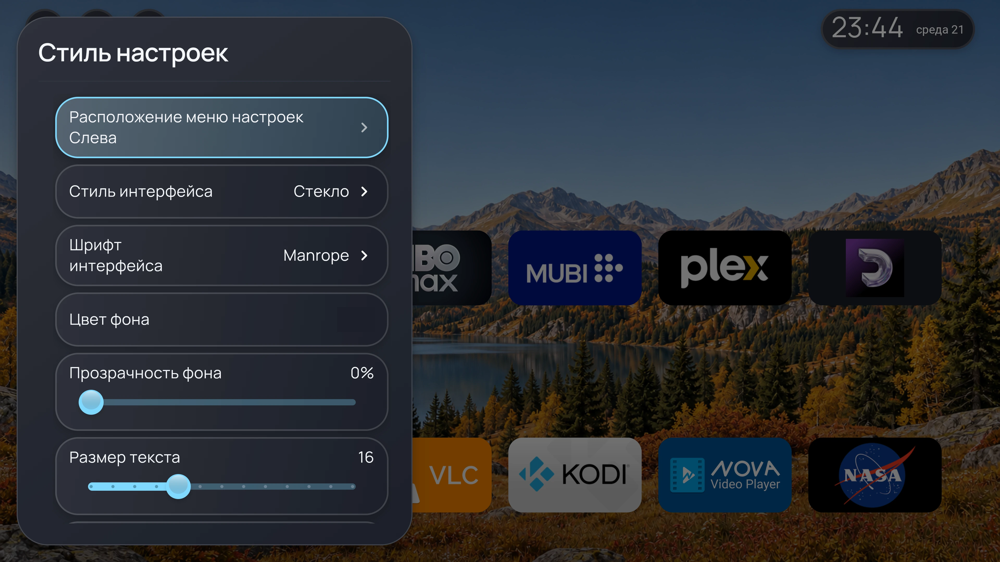](docs/images/screenshots/02-glass-settings.webp) | [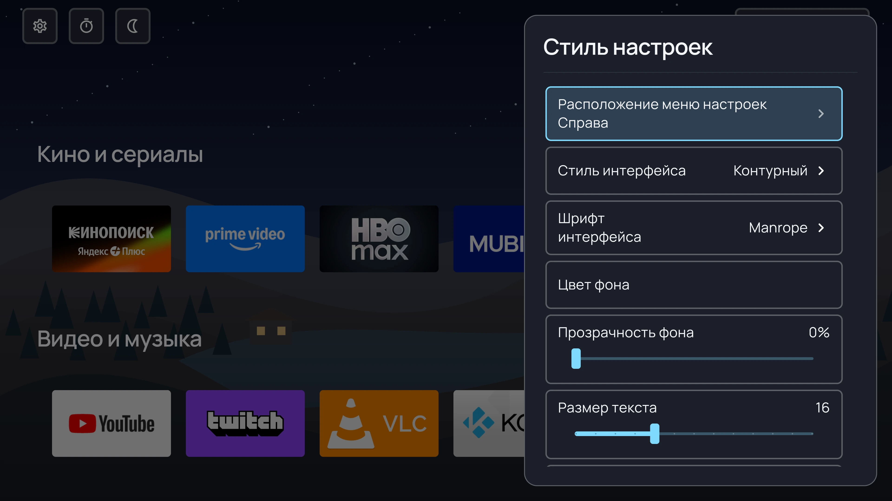](docs/images/screenshots/10-outline-settings.webp) |

| Календарь с верхней панели | Таймер отключения |
|---|---|
| [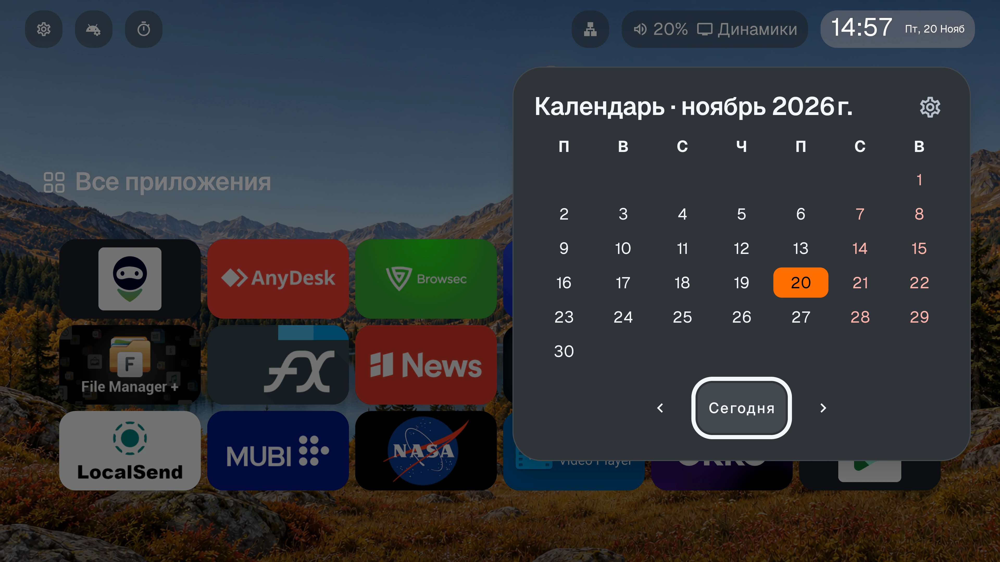](docs/images/screenshots/03-calendar.webp) | [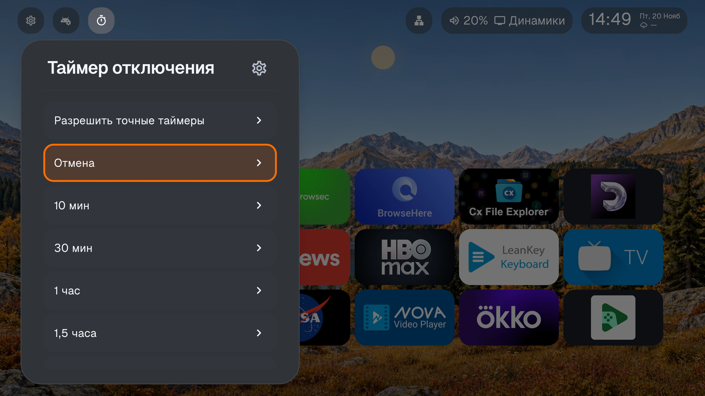](docs/images/screenshots/04-sleep-timer.webp) |

| Свои разделы приложений | Настраиваемая верхняя панель |
|---|---|
| [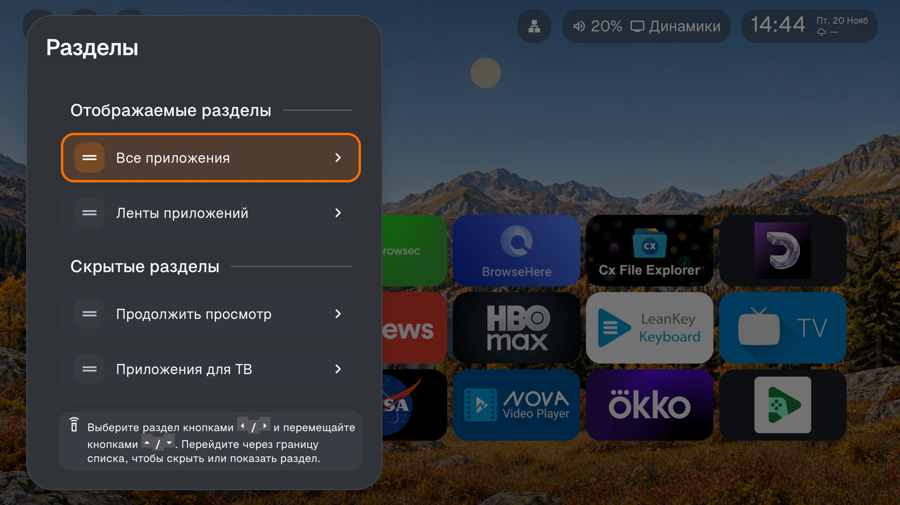](docs/images/screenshots/06-sections.webp) | [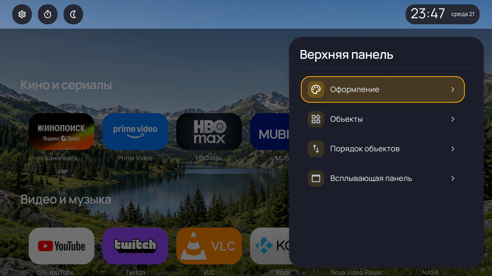](docs/images/screenshots/08-top-panel.webp) |

| Адаптивные обои | Размеры и подписи плиток |
|---|---|
| [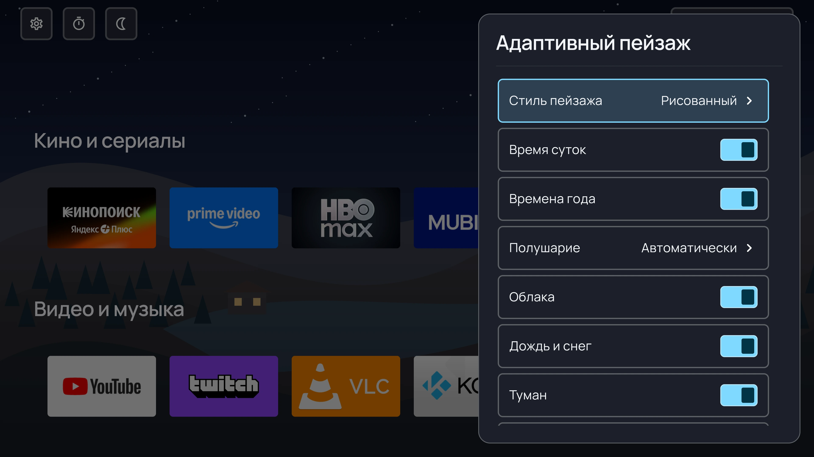](docs/images/screenshots/11-adaptive-wallpaper.webp) | [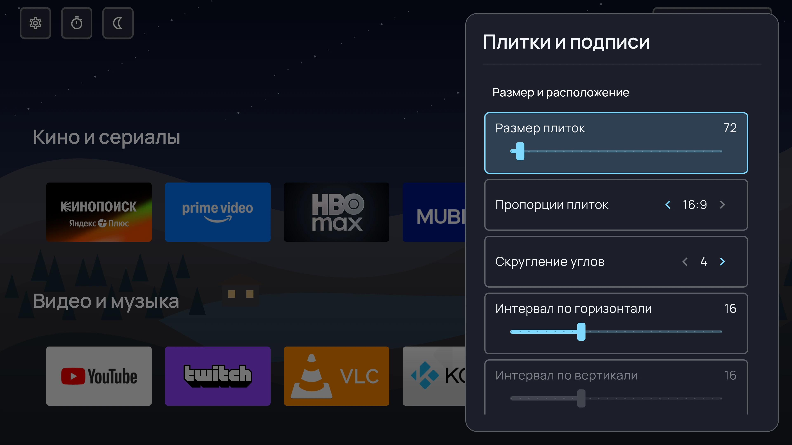](docs/images/screenshots/12-tile-appearance.webp) |

**Рисованный пейзаж**

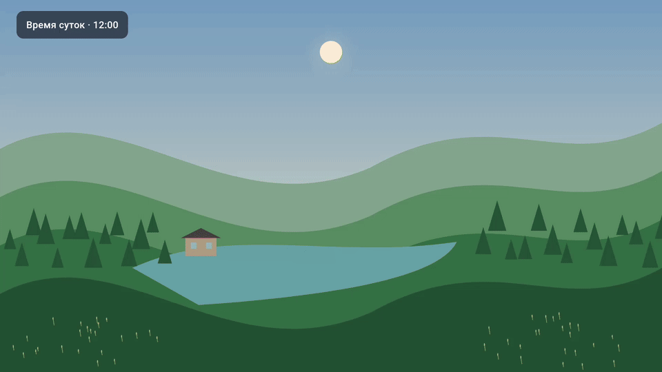

**Реалистичный пейзаж**

## Основные возможности

### Приложения и домашний экран

Пользовательские разделы, избранное, сортировка, скрытые и системные приложения,
собственные баннеры плиток и быстрый доступ к сведениям о приложении.
«Продолжить просмотр» показывает программы из системного Watch Next там,
где их предоставляют прошивка и установленные приложения.

### Фон, виджеты и мультимедиа

Локальные изображения и папки обоев, онлайн-обои Bing, дневной и ночной фон,
а также фон по изображению выбранного приложения. Часы и дата имеют собственное
оформление; по дате открывается календарь. Погода поддерживает Breezy Weather,
Open-Meteo, MET Norway, OpenWeather и Яндекс с требованиями выбранного источника.
После выдачи соответствующего доступа доступны уведомления и карточка
«Сейчас воспроизводится» с действиями активного плеера.

### Ночной режим и повседневное управление ТВ

Плавные переходы ночного фильтра, расписание системной яркости, часы и заставка,
таймер перехода в ожидание, переключение доступных входов и подписи HDMI/CEC.
Есть настройка домашнего приложения, восстановление прежнего HOME и встроенное
подключение ADB для поддерживаемых системных действий. Ремаппер позволяет задавать
короткое нажатие и удержание кнопок, запуск приложения, Home/Back, webhook
и открытие панели быстрых настроек. Доступность системных действий зависит от прошивки.

### Сохранность настроек и диагностика

Ручные и автоматические копии, локальные папки, WebDAV и Google Drive при
настроенном доступе. Выборочная синхронизация позволяет оставить часть настроек
индивидуальной для каждого ТВ. Встроены проверка обновлений APK, сведения
о памяти, режим экономии ресурсов и экспорт диагностических отчётов.

Менеджер отключения приложений показывает пакеты и их состояния, поддерживает импорт
списков, отключение выбранных приложений через ADB и восстановление сохранённого
состояния. Он не удаляет данные приложений; безопасность стороннего списка
отключений нельзя считать подтверждённой для любой модели ТВ.

## Установка и совместимость

Скачайте APK из [последнего релиза](https://github.com/KirillShchetinnikov/CuteLauncher-Releases/releases/latest)
и установите его на телевизор или приставку. Доступны ARMv7, ARM64, x86_64
и universal. Universal включает ARMv7 и ARM64; для x86_64 нужен отдельный APK.
Android может потребовать разрешение установки из выбранного источника.

Требуется **Android 9 или новее**. Выбор домашнего приложения, Home, ADB, наложения,
подсветка, уведомления и входы зависят от прошивки и выданных доступов.
Лаунчер можно использовать для запуска и организации приложений без включения
всех дополнительных системных интеграций.

Подробности доступности и ограничения приведены в
[руководстве](docs/USER_GUIDE_RU.md#разрешения-и-ограничения).

## Поддержать разработчика

На ТВ QR-коды доступны в «Настройки лаунчера → О программе CuteLauncher →
Поддержать разработчика». Поддержать разработку CuteLauncher можно через [CloudTips](https://pay.cloudtips.ru/p/118c2a7f) или [ЮMoney](https://yoomoney.ru/fundraise/1LLAULV57ME.261119).

## Сообщить об ошибке

Повторите проблему и откройте **Настройки → Диагностика → Диагностика**.
Нажмите **Создать отчёт → Экспортировать отчёт → Сохранить на диск**.
Единый файл `cutelauncher_diagnostics_….json` содержит ошибки, снимки настроек
на момент сбоев и сведения о совместимости ТВ. Передавайте его автору **в ЛС**,
не выкладывайте открыто: автоматическая очистка может пропустить личные данные.
Отправляя отчёт автору, вы соглашаетесь на размещение обезличенного отчёта
о совместимости ТВ в Git-репозитории CuteLauncher. Публикуются только сведения
об устройстве и доступности функций без личных данных; журнал ошибок, команды
и ваши настройки не публикуются. Опишите шаги, ожидаемый и фактический результат.
Подробности — в [инструкции по отчётам](docs/USER_GUIDE_RU.md#как-сообщить-об-ошибке).

## Документация и исходный код

- [Руководство пользователя](docs/USER_GUIDE_RU.md) — функции, пути в настройках,
  разрешения и ограничения.
- [Установка, разрешения и ограничения](docs/USER_GUIDE_RU.md#разрешения-и-ограничения) —
  требования дополнительных функций и особенности прошивок.
- [Документация](docs/README.md) — навигация по руководству, авторство и лицензии.

Открытый код и APK находятся в
[KirillShchetinnikov/CuteLauncher-Releases](https://github.com/KirillShchetinnikov/CuteLauncher-Releases).
Документация доступна на русском и английском; ссылки переключения находятся
в начале каждой страницы.

## Лицензия и авторство

Автор CuteLauncher — [Kirill Shchetinnikov](https://github.com/KirillShchetinnikov).

CuteLauncher развивается на основе LTvLauncher/FLauncher и распространяется
по [GNU GPLv3](LICENSE). Сведения об исходных проектах, авторах и лицензиях
библиотек и ресурсов — в [разделе о происхождении](docs/README.md#происхождение-и-лицензии).
