# CuteLauncher

[Русский](README.md) · [English](README_EN.md)

**A home screen for Android TV and Google TV.** Keep your favorite apps, content feeds, and TV controls together on an ad-free home screen. Navigate with the arrow keys and OK on your remote. Requires Android 9 or later.

**[Download APK](https://github.com/KirillShchetinnikov/CuteLauncher-Releases/releases/latest)** · [How to install](#installation-and-compatibility) · [What's new](CHANGELOG_EN.md)

[Project website](https://kirillshchetinnikov.github.io/CuteLauncher-Releases/en/) · [User guide](docs/USER_GUIDE_EN.md) · [FAQ](docs/FAQ_EN.md) · [All documentation](docs/README_EN.md)

[Discussion on 4PDA (in Russian)](https://4pda.to/forum/index.php?showtopic=1128313&view=findpost&p=145636324) · [Support the developer](#support-the-developer)

## What you can do from the home screen

- **Put your apps in order.** Keep favorites in the first row, organize other apps into categories, and hide tiles you rarely use. Each category can have its own row or grid layout.
- **Pick up where you left off.** When a streaming app shares its progress with Android TV, its Continue watching card takes you back to the film or episode.
- **Control the TV with your remote.** Hold OK on a tile for app actions. Add TV inputs, notifications, and the sleep timer to the quick settings panel.
- **Make the screen easy to read from the couch.** Adjust the clock, tile and label sizes, and choose a focus highlight you can see at a glance. Place the weather and date next to the clock or change the wallpaper by time of day.
- **Set up evening viewing.** Turn on the night filter manually, on a schedule, or at sunset. Exclude individual apps and HDMI inputs when they need their usual colors.
- **Bring your setup to another TV.** Back up your categories and appearance settings, or choose which settings to sync between devices.

## Screenshots and appearance

Show 14 screenshots and animated wallpapers

Example setups captured on Android TV and Google TV emulators (Android 16). Every image comes from the running app at 3840 × 2160; click an image to open the original. The third-party apps shown are installed separately.

| Glass · autumn landscape | Standard style · graphite gradient |
|---|---|
| [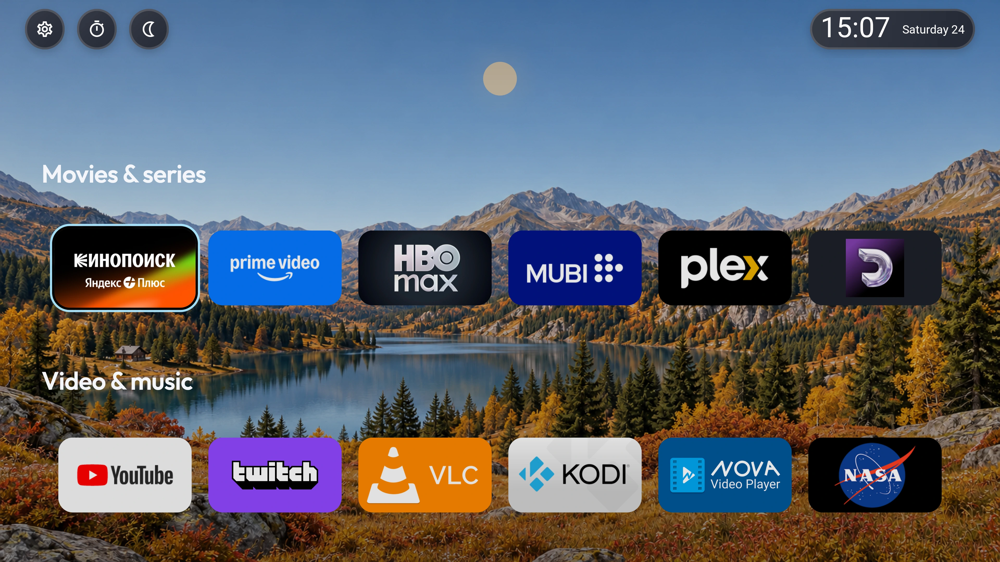](docs/images/screenshots/en/01-glass-autumn.webp) | [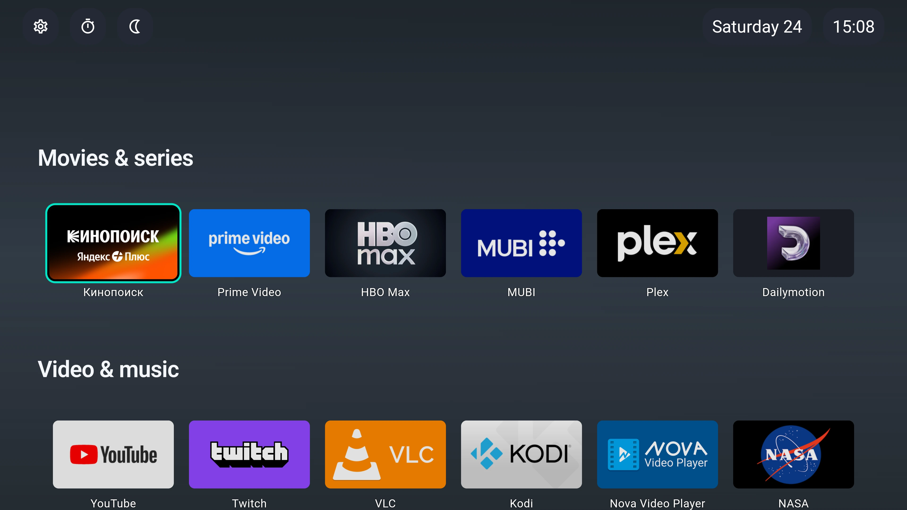](docs/images/screenshots/en/05-standard-gradient.webp) |

| Soft style · spring landscape | Outline style · illustrated night landscape |
|---|---|
| [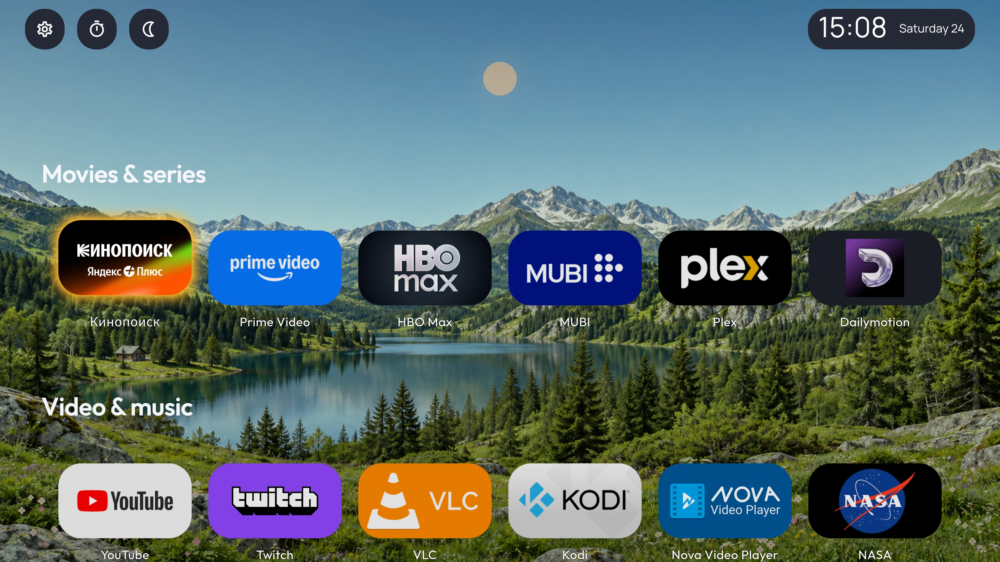](docs/images/screenshots/en/07-soft-spring.webp) | [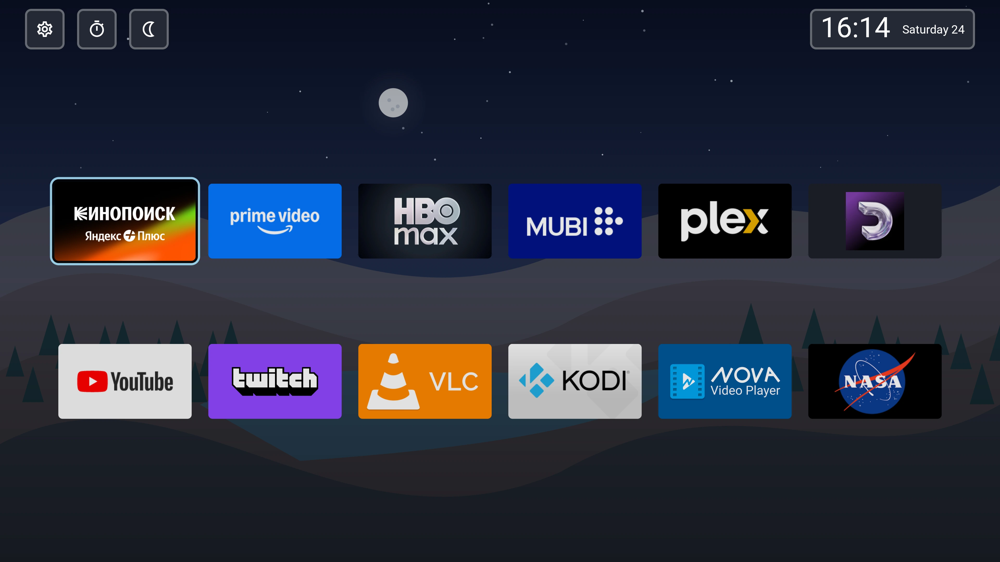](docs/images/screenshots/en/09-outline-night.webp) |

| Dynamic colors · six-column grid | Quick settings panel · sleep timer |
|---|---|
| [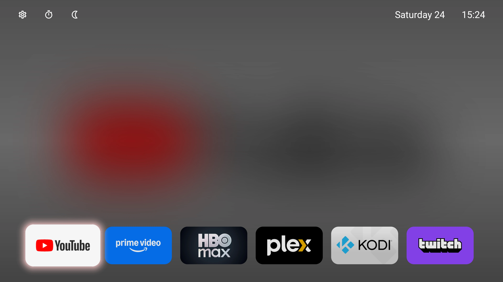](docs/images/screenshots/en/13-dynamic-grid.webp) | [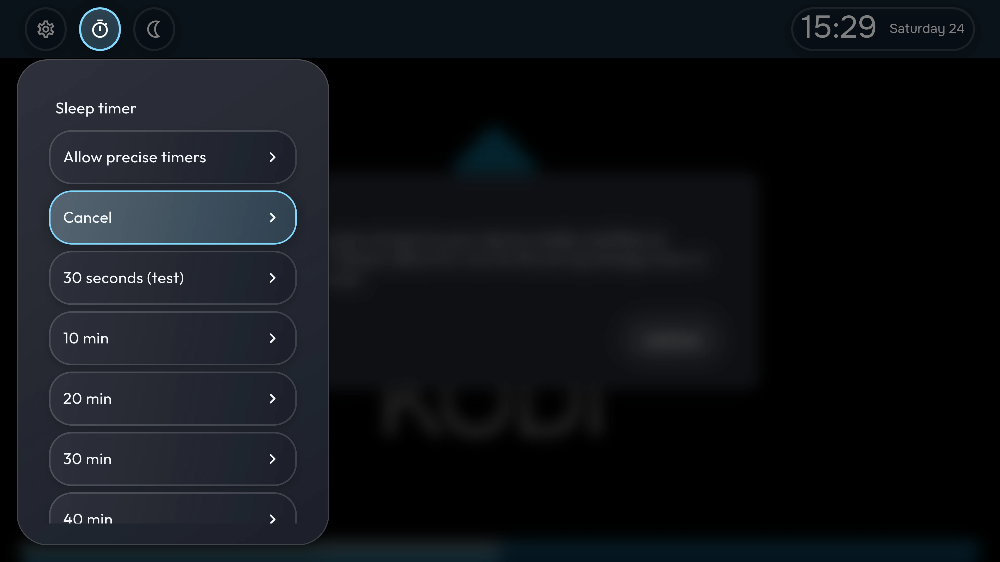](docs/images/screenshots/en/14-floating-panel-timer.webp) |

The app background in the quick settings panel screenshot is blurred for clarity.

| Glass settings | Outline settings |
|---|---|
| [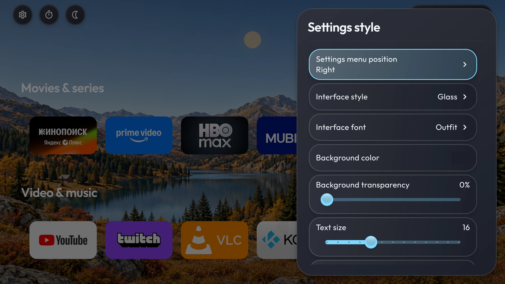](docs/images/screenshots/en/02-glass-settings.webp) | [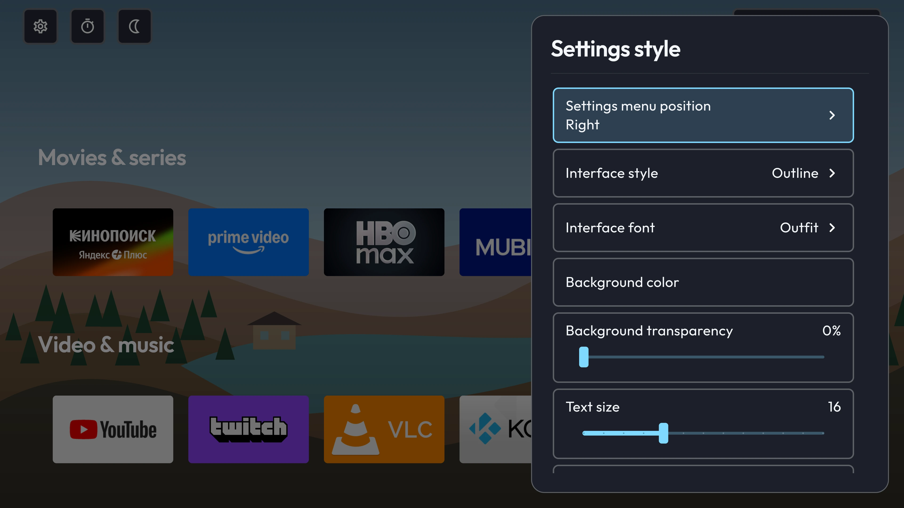](docs/images/screenshots/en/10-outline-settings.webp) |

| Calendar from the top panel | Sleep timer |
|---|---|
| [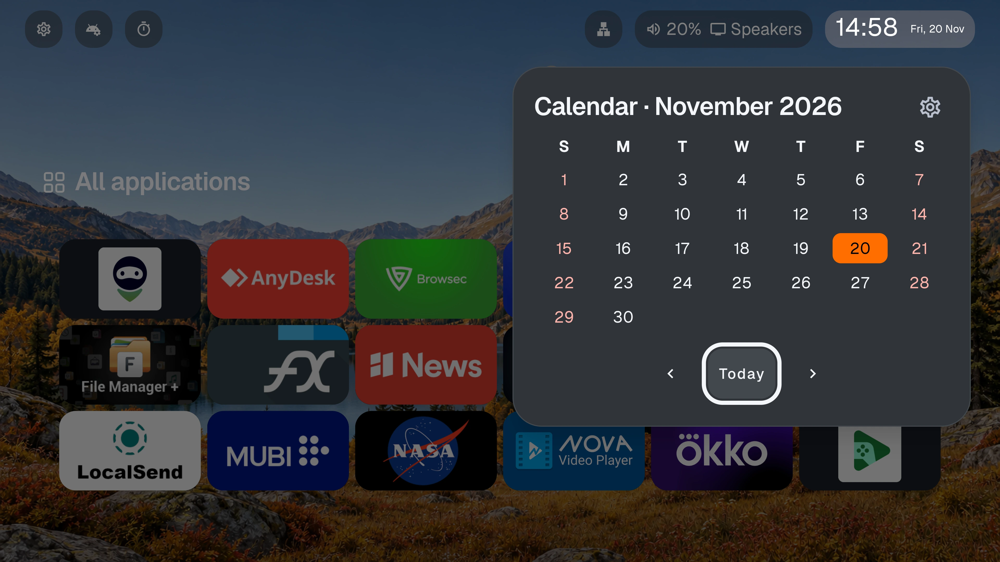](docs/images/screenshots/en/03-calendar.webp) | [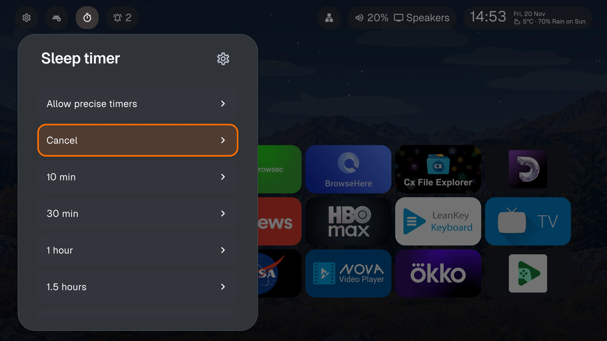](docs/images/screenshots/en/04-sleep-timer.webp) |

| Your own app categories | Customizable top panel |
|---|---|
| [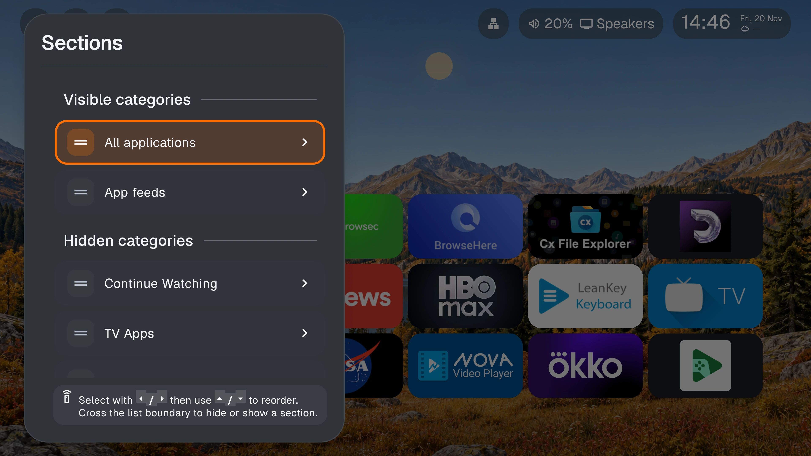](docs/images/screenshots/en/06-sections.webp) | [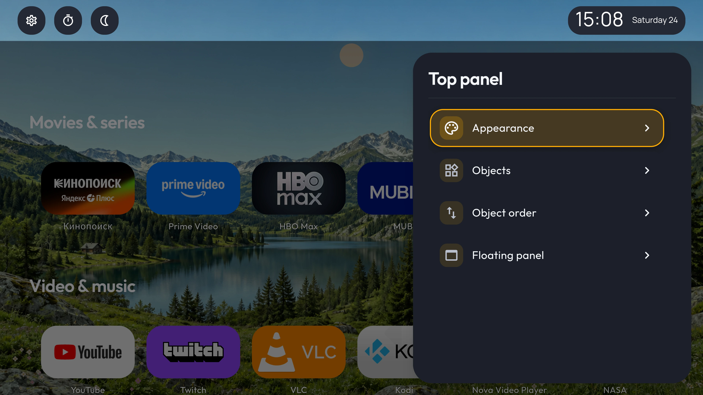](docs/images/screenshots/en/08-top-panel.webp) |

| Adaptive wallpapers | Tile sizes and labels |
|---|---|
| [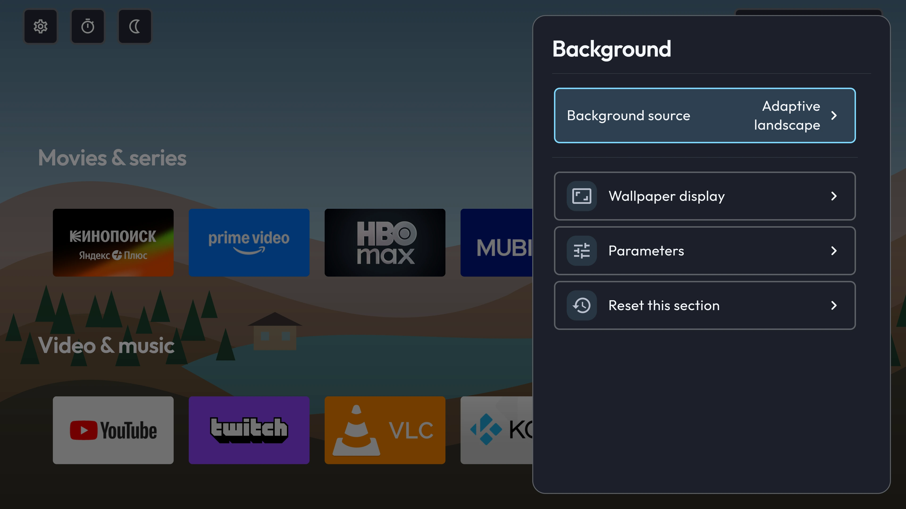](docs/images/screenshots/en/11-adaptive-wallpaper.webp) | [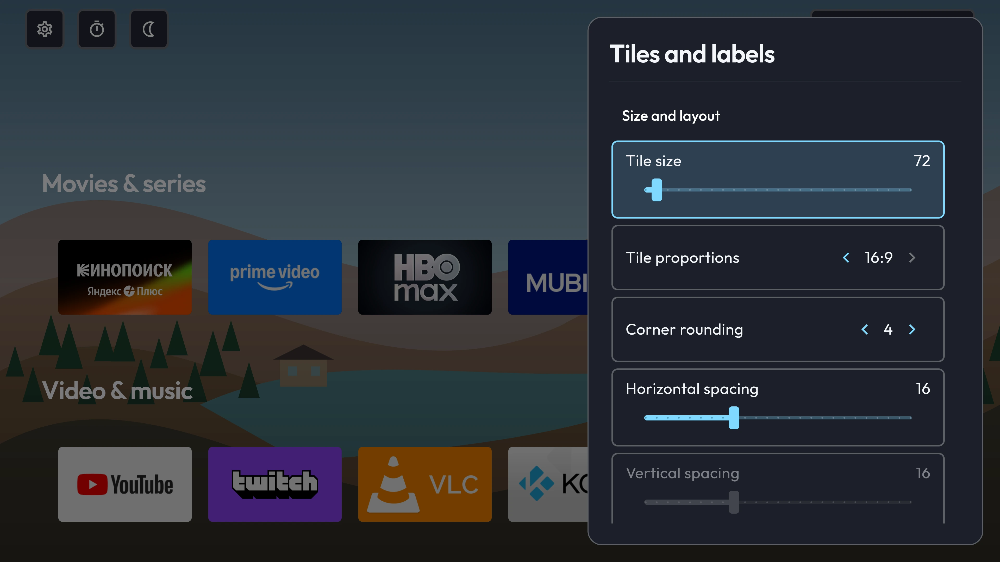](docs/images/screenshots/en/12-tile-appearance.webp) |

**Illustrated landscape**

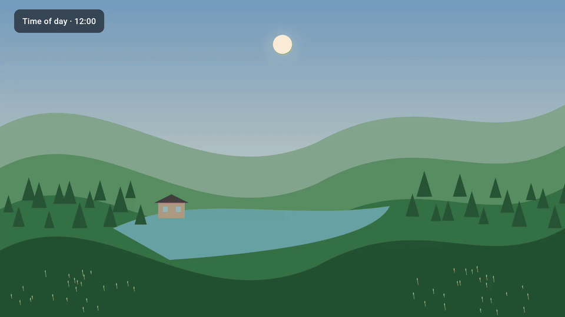

**Realistic landscape**

## Main features

### Apps and the home screen

Custom categories, favorites, sorting, hidden and system apps, custom tile
banners, and quick access to app details. Continue Watching displays programs
from Android's Watch Next service when the firmware and installed apps provide
the necessary data.

### Wallpapers, widgets, and media

Use local images and wallpaper folders, online Bing wallpapers, separate day
and night backgrounds, or a background based on the selected app's artwork.
Customize the clock and date, and open the calendar by selecting the date.
Weather supports Breezy Weather, Open-Meteo, MET Norway, OpenWeather, and Yandex, subject to
each provider's requirements. Grant notification access to see notifications and
a Now Playing card with the active player's supported controls.

### Night mode and everyday TV controls

Smooth night-filter transitions, system-brightness scheduling, a clock and
screensaver, a standby timer, available TV inputs, and HDMI/CEC labels.
Configure the home app, restore the previous HOME handler, and use the built-in
ADB connection for supported system operations. The remote remapper supports
short presses and holds, app launches, Home/Back, webhooks, and a quick settings panel.
Availability of system actions depends on firmware.

### Settings, backups, and diagnostics

Manual and automatic backups, local folders, WebDAV, and Google Drive with the
required access configured. Selective synchronization lets each TV retain some
of its own settings. Built-in tools include APK update checks, memory information,
a resource-saving mode, and diagnostic-report export.

The app disabling manager lists packages and their states, imports package lists,
disables selected apps through ADB, and restores saved states. It does not delete
app data. A third-party disable list cannot be assumed safe for every TV model.

## Installation and compatibility

Download an APK from the [latest release](https://github.com/KirillShchetinnikov/CuteLauncher-Releases/releases/latest)
and install it on your TV or TV box. ARMv7, ARM64, x86_64, and universal builds
are available. Universal includes ARMv7 and ARM64; x86_64 requires its separate APK.
Android may ask you to allow installation from your chosen source.

Requires **Android 9 or later**. Home-app selection, Home behavior,
ADB, overlays, backlight controls, notifications, and TV inputs depend on firmware
and permissions. You can launch and organize apps without enabling every
additional system integration.

See the [user guide](docs/USER_GUIDE_EN.md#разрешения-и-ограничения) for availability
and limitations.

## Support the developer

On TV, find the QR codes under Launcher settings → About CuteLauncher →
Support the developer. You can support CuteLauncher development through [CloudTips](https://pay.cloudtips.ru/p/118c2a7f) or [YooMoney](https://yoomoney.ru/fundraise/1LLAULV57ME.261119).

## Report an issue

Reproduce the issue and open **Settings → Diagnostics → Diagnostics**.
Select **Create report → Export report → Save to disk**.
The single `cutelauncher_diagnostics_….json` file contains errors, snapshots of
settings at each failure, and TV compatibility observations. Send it to the author
**in a private message**, not publicly: automatic redaction may miss personal data.
By sending the report to the author, you agree to publication of an anonymized TV
compatibility report in the CuteLauncher Git repository. Only device metadata and
feature availability are published, without personal data; error logs, commands
and your settings are not published. Describe the steps and expected/actual results.
See the [reporting instructions](docs/USER_GUIDE_EN.md#reporting-an-issue) for details.

## Documentation and source code

- [User guide](docs/USER_GUIDE_EN.md): features, settings paths, permissions, and
  limitations.
- [Installation, permissions, and limitations](docs/USER_GUIDE_EN.md#разрешения-и-ограничения):
  additional-feature requirements and firmware-specific behavior.
- [Documentation](docs/README_EN.md): guide navigation, attribution, and licenses.

Public source code and APKs are available in
[KirillShchetinnikov/CuteLauncher-Releases](https://github.com/KirillShchetinnikov/CuteLauncher-Releases).
Documentation is available in Russian and English. Language links appear at
the top of each page.

## License and attribution

CuteLauncher developer — [Kirill Shchetinnikov](https://github.com/KirillShchetinnikov).

CuteLauncher is based on LTvLauncher/FLauncher and distributed under
[GNU GPLv3](LICENSE). See [project origins and licenses](docs/README_EN.md#происхождение-и-лицензии)
for the original projects, authors, and licenses covering libraries and assets.
